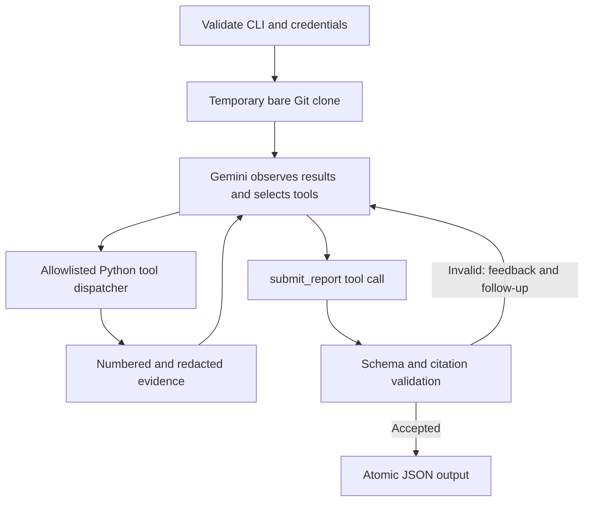

# DevOps Audit Agent

**Rayyan Qamar · Roll number 23i-0815 · Section A**
**MLOps & Production AI Engineering — Assignment 2**

[](https://github.com/bravocodes145/devops-audit-agent/actions/workflows/ci.yml)

A Python agent that investigates public GitHub repositories with **Gemini-selected
inspection tools**, follows evidence across files, and writes actionable DevOps
findings as JSON. Its loop, dispatch, budgets and validation are implemented
directly in Python. There is no LangChain, LangGraph, n8n or agent framework.

**Submission URL:** https://github.com/bravocodes145/devops-audit-agent
Submit **only that URL** in the course submission field. Setup, architecture,
evaluation, limitations and supporting material are included here.

- [Simple PDF report — details, screenshots and captions](docs/Rayyan_Qamar_23i-0815_Report.pdf)
- [Authentic public-repository JSON output](sample_report.json)
- [Sanitized public-audit trace](docs/sample.trace.jsonl)
- [Measured local evaluation](docs/evaluation/latest/summary.json)

## Installation and API setup

Requires **Python 3.11+**, **Git**, and internet access to GitHub and Gemini.
Runtime and offline tests use the standard library; no runtime packages are needed.

```bash
git clone https://github.com/bravocodes145/devops-audit-agent.git
cd devops-audit-agent
python -m venv .venv
```

Activate on Windows PowerShell:

```powershell
.\.venv\Scripts\Activate.ps1
```

Or on macOS / Linux:

```bash
source .venv/bin/activate
```

```bash
python -m pip install -r requirements.txt
```

Create your own key at [Google AI Studio](https://aistudio.google.com/apikey).
Use a project eligible for the free tier. Copy `.env.example` to `.env` next to
`agent.py` and configure **your own credentials**:

```dotenv
GEMINI_API_KEY=your_key
GEMINI_MODEL=gemini-3.1-flash-lite
```

Environment variables take precedence over `.env`. The loader never executes or
interpolates values. `.env` is ignored by Git. No personal key is distributed;
evaluators configure their supplied API credentials.

The default model was verified through live calls. Availability and free quotas
vary by project; see Google's [pricing](https://ai.google.dev/gemini-api/docs/pricing)
and [models](https://ai.google.dev/gemini-api/docs/models). If needed, change
`GEMINI_MODEL` to an available Gemini text model with native function calling.
The application never switches to a paid provider.

## Required execution interface

```bash
python agent.py --repo https://github.com/psf/requests --output report.json
```

Runs unattended. A completed inspection writes valid UTF-8 JSON and exits `0`,
including when there are no findings. Fatal errors exit `1` with useful stderr;
interrupts exit `130`. A failed run preserves any previous completed report,
so always check the exit status.

For a sanitized trace and explicit budgets:

```bash
python agent.py --repo https://github.com/psf/requests --output report.json --trace audit.trace.jsonl --max-steps 32 --timeout 1200
```

`--max-steps` limits model/tool turns (2–100); a turn can contain independent calls.
`--timeout` limits investigation seconds (30–3600), excluding the 120-second clone
timeout. An in-progress Git operation can take up to 30 seconds to finish. Traces
are optional and separate from the strict report JSON.

Accepts only `https://github.com/owner/repository`, optionally ending in `.git`.
Local paths, SSH, URL credentials, other hosts, branch paths, query strings and
fragments are rejected. The default branch's HEAD is pinned for the entire audit.

## Output contract

The included `sample_report.json` is unedited output of a real public audit:

```json
{
  "repository": "https://github.com/psf/requests",
  "violations": []
}
```

An empty array means no violation was substantiated within the inspected scope;
it does not certify that a repository has no defects. Every violation must contain
**exactly these eight fields**:

| Field | Meaning |
| --- | --- |
| `rule_id` | Stable identifier such as `SEC-001`, `CI-001` or `CFG-001` |
| `category` | DevOps inspection category |
| `severity` | Exactly `critical`, `high`, `medium` or `low` |
| `file` | Tracked repository-relative path, or JSON `null` for a repository-level absence |
| `line` | Positive inspected line number, or JSON `null` with a null file |
| `description` | Concrete problem and impact |
| `evidence` | Exact excerpt from the cited inspected line; inventory evidence for absences |
| `recommendation` | Actionable remediation |

See [actual findings on the flawed local fixture](docs/evaluation/latest/obvious.json)
for populated examples. Local evaluation reports use `fixture://` identifiers
to distinguish them honestly from public CLI targets. Secret values are not evidence.

## Architecture: explicit agent loop



1. **Observe:** the agent receives the URL and snapshot commit and discovers files
   through `list_files`.
2. **Reason and select:** Gemini chooses reads/searches based on returned languages,
   scripts and configuration. Subsequent tool order is not hardcoded.
3. **Execute:** Python validates arguments and dispatches approved read tools.
   Errors, skipped files and pagination become observations.
4. **Interpret and follow up:** the model inspects referenced scripts, suspicious
   context and alternative mechanisms before concluding.
5. **Report:** Gemini calls `submit_report`. Python rejects invalid severities,
   missing fields, nonexistent or unread citations, and evidence absent from the
   cited line. Errors return to the model for further inspection or correction.
   Submission cannot share a turn with uninterpreted inspection results.

There is no precomputed findings list or scanner fallback. LLM unavailability
causes failure rather than a fabricated report. The trace records selected tools,
arguments, observations and validation feedback, without private model reasoning
or opaque thought signatures. Provider signatures are preserved in memory for
native function-call compatibility.

| Tool | Implementation and boundaries |
| --- | --- |
| `list_files(offset, limit)` | Tracked HEAD paths, modes, byte sizes and explicit pagination |
| `read_file(path, start_line, end_line)` | Numbered redacted Git blob text; up to 300 lines / 24,000 characters |
| `search_code(pattern, offset, limit)` | Case-insensitive **literal** search with pagination and skipped-file metadata |
| `git_log(limit)` | Up to 60 recent default-branch commits; messages treated as untrusted data |

`tools.py` supplies inspection. `auditor/provider.py` handles Gemini REST and bounded
retries. `auditor/loop.py` owns the loop and schemas; `auditor/contracts.py` enforces
report/evidence requirements. `auditor/safety.py` validates inputs and redacts
recognizable secrets **before** inspected content reaches Gemini.

## Scope and precision policy

Inspection covers repository hygiene, dependencies, code quality, testing,
CI/Actions, security, configuration, collaboration and build/release when relevant.
The agent follows references between files and separates independent root causes
while avoiding duplicate reports.

Missing optional tools/files are not automatically violations. Equivalent CI,
linters and dependency workflows are accepted. The agent cannot infer remote
branch protection, claim test results without execution, or label ordinary
read-only PR testing as a privileged trust violation. ML training, datasets,
model validation and experiment tracking are excluded as the assignment requires.

## Safety and reliability

- **No target checkout, editing or execution.** Tools read Git objects in a temporary
  bare clone. Target hooks, dependencies, tests, builds and submodules are not run.
  Subprocess calls use argument arrays without a shell.
- Reads use tracked blob IDs. Absolute paths, traversal, binary reads, symlinks,
  submodules and oversized files are rejected or explicitly skipped.
- Cloning permits HTTPS only, disables interactive credential prompts, isolates
  Git configuration, and cleans temporary storage after success or failure.
- Redaction covers recognizable provider tokens, credential assignments/URLs,
  private keys and the configured key. Environment references and workflow policy
  values remain readable. Unusual/encoded secrets can evade this heuristic.
- Repository data is untrusted in the prompt. The allowlisted dispatcher enforces
  execution boundaries even if prompt injection affects model interpretation;
  interpretation bias remains a limitation.
- Limits: 20,000 tracked paths, 256 KiB per text blob, 16 MiB per search and 60
  history commits. Skipped/truncated checks are not negative evidence. Clone
  execution is time bounded, not protected by a separate disk quota.
- The agent does not query remote GitHub settings, branch protections or CI-run
  history. Optional target test/lint execution is omitted. This project's own
  trusted tests run locally and in CI.
- Invalid input, missing Git/files, API errors, timeouts, malformed responses and
  exhausted budgets are handled explicitly. Transient failures retry within a
  deadline; HTTP `429` honors bounded numeric `Retry-After` values.

Gemini receives redacted inspected text, not the provider key. Google's free-tier
data terms apply; public GitHub repositories are the only supported targets.

## Tests and measured evaluation

```bash
# Offline: no key or network calls
python -m unittest discover -v

# Development checks and report tooling
python -m pip install -r requirements-dev.txt
python -m ruff check .
python -m ruff format --check .

# Explicit opt-in: spends Gemini quota on local synthetic Git repositories
python -m scripts.evaluate --live
```

**41 offline tests** cover tool behavior, pagination, redaction, workflow-policy
preservation, URL/path and symlink boundaries, dynamic follow-up calls, citation
repair, empty reports, CLI failures/atomic output, signatures and provider retries.
Model tests use test doubles; these do not measure live detection performance.

CI runs lint, formatting and tests on **Python 3.11?3.14**, with read-only permissions and pinned action commits. The badge links to current workflow runs.

Live evaluation used `gemini-3.1-flash-lite`:

| Local synthetic fixture | Reference defects found | Findings | Target unchanged |
| --- | --- | --- | --- |
| Obvious CI/configuration defects | 2 / 2 | 2 | Yes |
| Subtle workflow/security defects | 1 / 2 | 1 | Yes |
| Healthy utility with equivalent checks | 0 / 0 | 0 | Yes |

This run matched 3 of 4 injected defects: **75% recall** and **100% provisional
precision** (3 matching findings / 3 reported). The healthy case had no reported
false positives. The missed issue was direct PR-title interpolation into shell
code. Scoring uses accepted file/line locations; extra findings need human review.
This small known fixture set does **not** estimate instructor hidden-test results.

The real public CLI audit inspected
[`psf/requests` at `611c616`](https://github.com/psf/requests/tree/611c6162cbc4ac2020a2f91c7cfa4f3abf9bbb60),
completed in **10 model/tool turns** and returned zero findings. Its unedited
output and trace are linked above. This is a model assessment, not an exhaustive
independent certification.

An earlier run raised an unsupported warning about normal PR checkout in CodeQL.
Its [original output](docs/evaluation/baseline/requests.json) and
[trace](docs/evaluation/baseline/requests.trace.jsonl) are preserved. After general
instructions were strengthened to require concrete failure modes and recognize
equivalent safe practices, a subsequent run returned zero findings. Valid citations
do not eliminate semantic false positives or model variability. The original
[local baseline](docs/evaluation/baseline/summary.json) is also preserved.

## Screenshots and simple PDF

[Open the PDF](docs/Rayyan_Qamar_23i-0815_Report.pdf). It includes Rayyan Qamar,
23i-0815, Section A, and a short explanation under each screenshot.
Images are actual Edge captures from this computer: saved CLI/test/check output,
real evaluation artifacts and the public GitHub page. They are browser captures,
not native terminal screenshots. [Raw sources and capture times](docs/evidence)
are included for review.

Regenerate after installing development requirements (Microsoft Edge is required):

```bash
python -m scripts.collect_evidence
python -m scripts.build_report
```

## Submission contents

Includes `agent.py`, root `tools.py`, agent modules, install/setup files,
`.env.example`, README, automated tests, authentic `sample_report.json`, traces,
evaluation evidence and supplemental PDF. Screenshots and PDF support the
executable implementation and do not replace it.

**Submit only: https://github.com/bravocodes145/devops-audit-agent**
